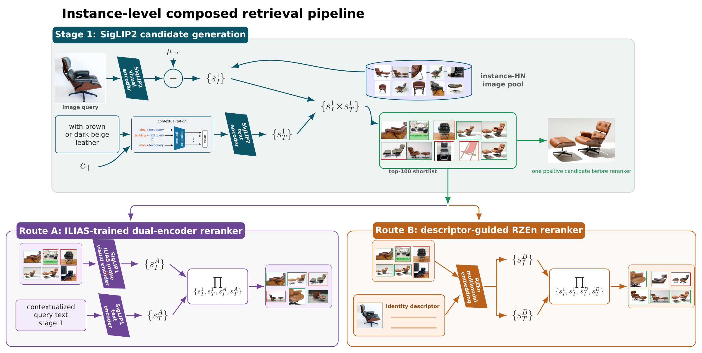

# Instance-Based Composed Image Retrieval

<div align="center">

**Identity-preserving retrieval from a reference image and a textual modification**

[](https://www.python.org/)
[](LICENSE)
[](https://github.com/aminalmasi/instance-based-composed-image-retrieval/releases/tag/v0.1.0)
[](tests)
[](https://aminalmasi.github.io/instance-based-composed-image-retrieval/)

Implementation of the two-stage framework developed for the master's thesis<br>
**Instance-Based Composed Image Retrieval with Vision-Language Models**.

</div>

## The problem

A composed query contains a **reference image** and a **textual modification**. In conventional
composed image retrieval, broad semantic compatibility may be enough. In the instance-based
setting, a relevant candidate must satisfy two conditions simultaneously:

1. it depicts the same literal product, character, landmark, artwork, or object;
2. it visually satisfies the requested modification.

| Candidate behavior | Same instance | Modification satisfied | Relevant |
|---|:---:|:---:|:---:|
| Correct identity in the original state | Yes | No | No |
| Different identity with the requested change | No | Yes | No |
| Correct identity with the requested change | Yes | Yes | **Yes** |

This distinction matters in product search, cultural archives, creative tools, and visual search
systems where returning a similar category is not sufficient. The challenge is to preserve subtle
identity cues without allowing them to overwhelm the requested change. The method therefore keeps
identity and modification evidence separate and combines them with multiplication, which acts as a
strict agreement rule: one strong branch cannot compensate for failure on the other.

## Method overview

The pipeline first builds a high-recall shortlist and then applies one of two identity-focused
verification routes. Every query is evaluated inside its official ICIR instance-specific pool of
positives and curated hard negatives.

<p align="center">
  
</p>

**Stage 1: efficient candidate generation.** Frozen **SigLIP2 SO400M Patch16 384** provides
separate visual and textual evidence. Leave-one-instance-out centering suppresses broad visual
directions while preserving the query instance, and contextualization converts a short
modification into caption-like text queries. Their product produces the top-100 shortlist and the
two component scores are retained for reranking.

**Route A: supervised dual-encoder verification.** A SigLIP1 linear projection trained with ILIAS
instance-retrieval supervision adds a stronger image-identity score. Frozen SigLIP1 contributes a
second contextualized modification score. This route tests whether instance information already
present in a frozen embedding space can be exposed by lightweight adaptation.

**Route B: descriptor-guided multimodal verification.** An offline identity descriptor tells
RZEnEmbed-7B which literal instance to emphasize when representing each shortlisted candidate.
The resulting candidate embedding is compared with the RZEn image and modification queries. This
route combines heterogeneous model agreement with explicit identity guidance.

Both routes preserve the first-stage evidence and use a four-factor product:

```text
final score = stage-1 image score
            × stage-1 text score
            × reranker image score
            × reranker text score
```

Because both rerankers reorder a fixed top-100 shortlist, they improve precision-oriented metrics
without changing Recall@100.

## Main results

The full ICIR evaluation contains **1,883 queries**, **202 instances**, and **752,092 database
images**. Metrics follow the thesis protocol: AP@100 uses `min(number of positives, 100)` as its
denominator, Recall@100 uses all positives, and Macro-mAP@100 gives every instance equal weight.

| System | mAP@100 | Macro-mAP@100 | Recall@100 |
|---|---:|---:|---:|
| SigLIP2 first stage | 59.64 | 60.24 | 93.08 |
| Route A: ILIAS-trained dual encoder | 66.05 | 64.14 | 93.08 |
| **Route B: descriptor-guided RZEn** | **66.42** | **65.65** | **93.08** |

The strongest reranker improves the already strong first stage by **6.78 mAP@100 points** while
preserving its candidate recall. Route A reaches a competitive result with a substantially lighter
learned component, supporting the thesis finding that frozen embeddings already contain useful
instance-level structure.

## What is included

- Exact ICIR query-local candidate construction and metric definitions.
- Memory-efficient leave-one-instance-out centering for large feature banks.
- Text contextualization and factor-level multiplicative fusion.
- SigLIP and SigLIP2 feature extraction with adaptive out-of-memory backoff.
- Pairwise sigmoid, local InfoNCE, and multi-negative margin training losses.
- ILIAS linear-probe training and Route A reranking.
- Descriptor-guided RZEn extraction and Route B reranking.
- Deterministic ranking, experiment manifests, regression targets, and SLURM templates.
- Synthetic unit and end-to-end tests that do not require private datasets.

## Installation

```bash
git clone git@github.com:aminalmasi/instance-based-composed-image-retrieval.git
cd instance-based-composed-image-retrieval

python -m venv .venv
source .venv/bin/activate
pip install -e ".[models,dev]"
```

For metric and pipeline tests without loading the neural backbones:

```bash
pip install -e ".[dev]"
pytest -q
```

## Data and feature preparation

ICIR and ILIAS are distributed separately under their respective licenses. The repository does not
redistribute images, annotations, pretrained backbones, or large feature arrays. Configure their
locations in `.env`:

```bash
cp .env.example .env
```

The official local ICIR layout is expected to be:

```text
data/icir/
├── query/
├── database/
├── query_files.csv
└── database_files.csv
```

Validate the metadata and all instance-specific candidate pools before extracting features:

```bash
instance-cir validate-data --data-root "$ICIR_DATA_ROOT"
```

See [data preparation](docs/data.md), [descriptor preparation](docs/descriptors.md), and the
[supervision format](docs/supervision_format.md) for the complete schemas.

## Reproduction workflow

1. Extract normalized SigLIP2 query-image, contextualized-text, corpus, and database features.
2. Run the centered and contextualized first stage to create the fixed top-100 shortlist.
3. Extract aligned SigLIP1 probe scores or descriptor-guided RZEn scores for that shortlist.
4. Apply the configured four-variable product and evaluate with the thesis metric profile.
5. Compare the outputs with `reproducibility/thesis_targets.json`.

```bash
instance-cir stage1 \
  --data-root "$ICIR_DATA_ROOT" \
  --feature-manifest features/siglip2/manifest.json \
  --context-features features/siglip2/context_subject_features.npy \
  --output-dir outputs/stage1

instance-cir rerank \
  --rankings outputs/stage1/topk_rankings.csv \
  --score-bank features/route_b/rzen_scores.npz \
  --variables rzen_image,rzen_text \
  --output-dir outputs/route_b
```

Detailed commands, expected outputs, and regression checks are provided in
[docs/reproduction.md](docs/reproduction.md). The projection-head checkpoints and validated
descriptor table are available in the [`v0.1.0` release](https://github.com/aminalmasi/instance-based-composed-image-retrieval/releases/tag/v0.1.0).

## Repository structure

```text
configs/          Final data, first-stage, training, and reranking configurations
docs/             Method, metric, data, descriptor, and reproduction documentation
src/              Installable retrieval and training package
scripts/          Feature extraction, supervision preparation, and regression tools
slurm/            Optional cluster launch templates
tests/            Synthetic unit and end-to-end tests
checkpoints/      Release manifest, configurations, and artifact checksums
reproducibility/  Recorded full-benchmark metric targets
```

## Citation

If this repository contributes to your work, please cite the project using [CITATION.cff](CITATION.cff).

## Acknowledgments and license

This project builds on the ICIR benchmark and BASIC pipeline, SigLIP and SigLIP2, ILIAS, and
RZEnEmbed. Their datasets, pretrained models, and source code remain subject to their original
licenses. Original code in this repository is released under the [Apache License 2.0](LICENSE).
See [THIRD_PARTY_NOTICES.md](THIRD_PARTY_NOTICES.md) for attribution and redistribution notes.
